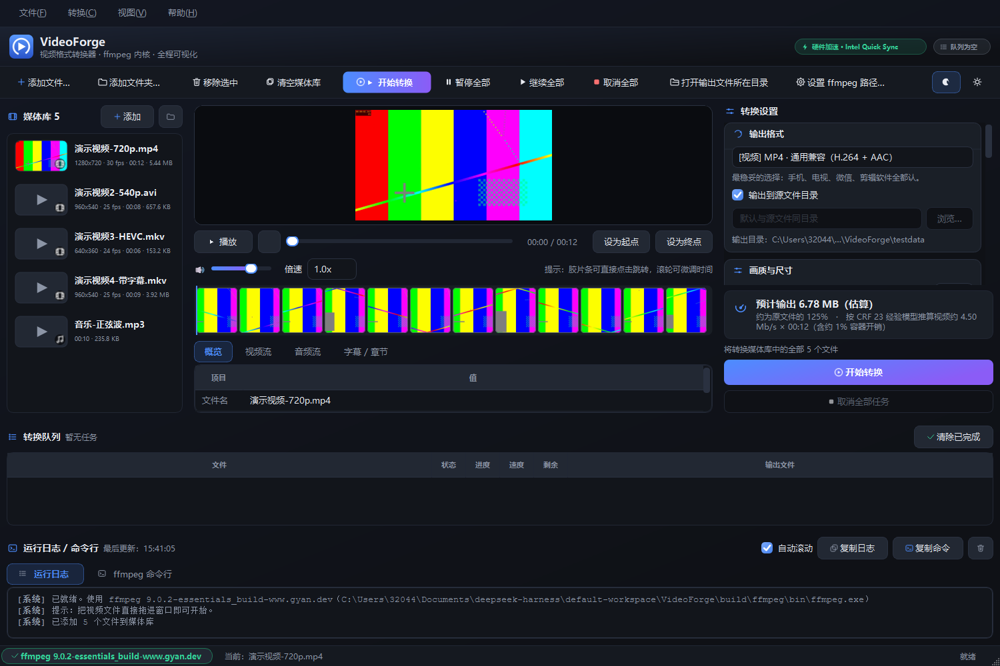
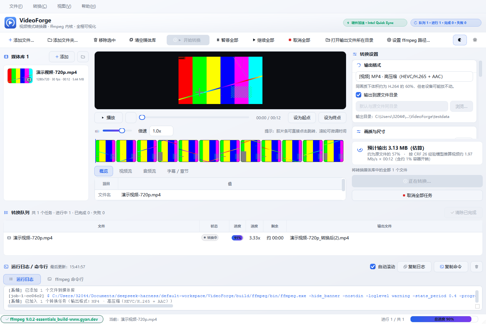

# VideoForge · 视频格式转换器

> 一个 **Windows 原生桌面客户端**（Qt 6 + C++17），基于 **ffmpeg 命令行** 完成音视频格式转换。
> 目标用户是"不懂编解码参数的普通人"：拖进来 → 看一眼 → 点开始 → 拿到文件。

[](https://github.com/OWNER/video-forge/actions/workflows/build.yml)

<!-- 推送前把上面两处 OWNER 换成你的 GitHub 用户名，否则徽章会 404 -->



> 批量转换完成：[深色](docs/images/02-批量转换完成.png) ·
> 转换中：[浅色主题](docs/images/03-转换中.png) ·
> [纯浅色界面](docs/images/04-浅色主题.png) ·
> [音频提取](docs/images/05-音频提取.png) ·
> [小屏适配 1366×740](docs/images/06-小屏适配.png)

---

## 为什么是桌面客户端

评审会优先看界面选型，这里直接给出结论和理由：

| 候选方案 | 结论 | 理由 |
|---|---|---|
| **Qt 6 Widgets + C++（本项目）** | ✅ 采用 | 原生 Win32 窗口、系统拖放、系统托盘、任务栏状态、直接调用本地 ffmpeg 进程、完全离线、`windeployqt` 打成免安装绿色包。**每一项都是客户端才有的能力。** |
| 纯 Web 页面 / 在线转换站 | ❌ 排除 | 与"客户端"关联度 **0**：文件要上传、要联网、没有本地进程能力。 |
| Electron / Tauri | ❌ 排除 | 本质是浏览器壳 / WebView 承载，客户端属性弱；分发依赖 Node 运行时，体积大。 |
| Python + GUI 库 | ❌ 排除 | 需要解释器与虚拟环境，分发体验差；给普通用户装 Python 不现实。 |
| Qt Quick (QML) | ⚪ 备选 | 同样是 Qt 客户端，但桌面工具类密集表单/表格更适合 Widgets，且本机工具链即带该模块。 |

客户端特征落地清单：

- 原生菜单栏 / 工具栏 / 状态栏，窗口布局、列宽、主题全部持久化
- **拖放**：文件、多个文件、整个文件夹，拖到窗口任意位置都能识别
- **剪贴板**：在资源管理器里复制文件，回窗口 `Ctrl+V` 直接导入
- **系统托盘**：转换中关窗口会问"要不要后台跑"，双击托盘图标恢复窗口
- **本地进程**：直接调用本机 ffmpeg，不上传任何数据，断网可用
- **绿色便携**：解压即用，不需要装 Qt、不需要装 ffmpeg

---

## 功能

### 1. 视频信息 + 缩略图（题目要求 1）
- `ffprobe` 读取完整媒体信息：容器、时长、总码率、文件大小，
  视频流（编码器/档次/分辨率/宽高比/帧率/像素格式/位深/色彩空间/旋转），
  音频流（编码器/声道布局/采样率/采样格式/码率/语言），字幕流、章节数
- **智能封面帧**：在 5 个候选时间点抽帧，按灰度标准差挑"最有内容"的一帧，
  自动跳过纯黑片头；结果写入磁盘缓存，二次打开秒显
- **胶片条**：沿时间轴均匀抽 12 帧拼成一条可点击的时间轴，点哪帧跳哪帧
- **媒体库缩略图**：每个文件在列表里都有小缩略图与信息摘要

### 2. ffmpeg 命令行转换（题目要求 2）
- 用 `QProcess` 组装并执行命令行，**不调用 ffmpeg API**
- 进度来自 `-progress pipe:1`：解析 `out_time_us / frame / fps / bitrate / total_size / speed`，
  换算成百分比、实时速度、剩余时间
- **命令行透明可查**：日志面板的"ffmpeg 命令行"标签页显示真正执行的完整命令，一键复制到终端复现

### 3. 自主优化（题目要求 3）
| 优化点 | 说明 |
|---|---|
| 批量队列 + 并发调度 | 一次导入整个文件夹，队列按并发上限（默认 2，可调）自动派发 |
| **只转选中项** | 媒体库里有选中项时只转选中的那些，并明确提示"将转换 N 个文件" |
| 预设系统 | 11 个预设覆盖 MP4/H.264、MP4/HEVC、WebM/VP9、MKV 无损换壳、MOV、AVI、GIF、MP3/M4A/WAV/FLAC |
| **字幕不再静默丢弃** | 可选择保留原字幕轨（MKV 直接复制、MP4/MOV 转 `mov_text`）；不保留时界面会明确提示会丢几条 |
| 硬件加速自动探测 | **真实试编码**验证 NVENC / QSV / AMF 在本机能否跑通（只看 `-encoders` 会误报）；不可用自动回退软编码并提示 |
| 输出体积预估 | 点开始之前就告诉用户"预计输出约 6.8 MB，约为原文件的 125%" |
| **磁盘空间预检** | 预计放不下时**直接阻止开始**，并明确告诉你"还差多少" |
| **转换后校验产物** | 不只看 ffmpeg 退出码：用 ffprobe 复核输出是否存在、流是否齐全、时长是否被截断 |
| 无损换壳 | MKV 预设直接复制音视频流，几秒完成、画质零损失（有端到端验证：输出了与源同样字节数的文件） |
| 裁剪片段 | 起止时间 + 播放器"设为起点/终点"按钮 + 胶片条点击定位 |
| 任务可控 | 暂停（挂起 ffmpeg 进程）/ 继续 / 取消 / 重试 / 移除 |
| 体积/兼容性兜底 | 10bit、yuv444 源自动补 `-pix_fmt yuv420p`，避免老设备黑屏 |
| 错误人话化 | "磁盘空间不足""文件被占用""源文件损坏"等，而不是丢一段 ffmpeg 英文报错 |
| 依赖自知 | 启动自动定位 ffmpeg（内置 → 用户本地数据目录 → PATH → 常见路径 → 手动选择），状态栏红/绿一眼看出 |
| **一键下载 ffmpeg** | 没找到 ffmpeg 时可以直接"自动下载并安装"：下载 → 解压 → 安装到程序目录 → 校验可执行 → 立即启用（含进度与取消） |
| 深浅主题 | 现代扁平 QSS，深色默认，一键切换 |
| 配置持久化 | 窗口几何、分栏比例、主题、输出目录、并发数、**上次用的预设与字幕策略**全部记住 |

### 4~7. 文档、GitHub、客户端形态、可用性
见 [docs/SESSION_SUMMARY.md](docs/SESSION_SUMMARY.md)（含**开发者决策记录与反馈**）、
[docs/TEST_REPORT.md](docs/TEST_REPORT.md)（**真实自测证据**）。

---

## 快速开始

### 方式一：绿色便携版（推荐给使用者）

1. 下载 `VideoForge-1.0.0-win64-portable.zip`
2. 解压到任意目录（路径含中文也没问题）
3. 双击 `VideoForge.exe`

包内已经内置 ffmpeg / ffprobe，**不需要**额外安装任何东西。

### 方式二：从源码构建（推荐给开发者）

需要：Qt 6.5+ (mingw_64)、MinGW 13、CMake 3.21+、Ninja。

```powershell
# 1) 下载 ffmpeg（构建/测试需要，约 115 MB）
powershell -ExecutionPolicy Bypass -File scripts/get-ffmpeg.ps1

# 2) 构建
powershell -ExecutionPolicy Bypass -File scripts/build.ps1 -RunTests

# 3) 打包绿色便携版
powershell -ExecutionPolicy Bypass -File scripts/package.ps1
```

脚本会自动寻找本机的 Qt / CMake / Ninja / MinGW；也可以显式指定：

```powershell
powershell -File scripts/build.ps1 -QtDir "C:/Qt/6.9.3/mingw_64" -Config Release -Clean
```

> **注意编码**：`scripts/*.ps1` 保存为 **UTF-8 with BOM**。
> Windows PowerShell 5.1 会把无 BOM 的 UTF-8 当 GBK 解码，导致中文字符串被拆坏、
> 脚本报语法错误。用编辑器改动脚本后请保持 BOM 编码。

产物：
- `build/VideoForge.exe` —— 主程序
- `build/vf_tests.exe` —— core 层单元测试（240 项断言）
- `build/vf_tests_job.exe` —— job 层单元测试（71 项断言，用 `vf_fake_ffmpeg` 当测试替身）
- `dist/VideoForge-1.0.0-win64-portable.zip` —— 绿色便携包（约 99 MB）

### 持续集成

`.github/workflows/build.yml` 会在每次 push / PR 时于 `windows-latest` 上
安装 Qt 6.9.3 + MinGW、配置、编译、跑 `ctest`，并上传构建产物。
单元测试不依赖真实 ffmpeg（job 层用测试替身），所以整个 CI 两分钟内能跑完。

---

## 使用说明

1. **导入**：把视频拖进窗口，或点"添加文件…"（`Ctrl+O`）/"添加文件夹…"（`Ctrl+Shift+O`）
2. **查看**：左侧列表选中文件 → 中间显示封面缩略图、胶片条、播放器与完整信息表
3. **选格式**：右侧选一个预设；不懂参数就别动其它选项，默认值就是推荐值
4. **开始**：点"开始转换"（`F5`）；底部队列显示进度、速度、剩余时间
5. **查看命令**：日志面板 → "ffmpeg 命令行"标签页 →"复制命令"，可自行到终端复现
6. **结果**：双击队列里已完成的任务可播放输出文件，右键可"打开所在文件夹"

### 常用快捷键

| 快捷键 | 功能 |
|---|---|
| `Ctrl+O` / `Ctrl+Shift+O` | 添加文件 / 添加文件夹 |
| `Ctrl+V` | 粘贴剪贴板中的文件路径 |
| `F5` | 开始转换 |
| `Delete` | 从媒体库移除选中项 |
| 胶片条点击 / 滚轮 | 跳转到指定时间 / 微调时间 |

---

## 界面结构



```
┌──────────────────────────────────────────────────────────────────────┐
│ 品牌区：logo · VideoForge · 副标题           [硬件加速·QSV] [队列统计] │
│ 操作栏：添加/移除/清空 | 开始(渐变)/暂停/取消 | 输出目录/设置 ffmpeg   │
├─────────────┬────────────────────────────────┬───────────────────────┤
│ 媒体库       │ 预览（圆角画面区）               │ 转换设置（卡片式）     │
│ · 缩略图卡片 │ · 播放器（Qt Multimedia）        │ · ◜ 输出格式          │
│ · 类型徽标   │ · 播放控制 / 设为裁剪起点终点     │ · ◜ 画质与尺寸        │
│ · 分辨率·时长│ · 胶片条（12 帧，可点击）        │ · ◜ 音频             │
│ · 体积       │ · 信息表：概览/视频/音频/字幕章节 │ · ◜ 裁剪             │
│             │                                 │ · ◜ 高级             │
│             │                                 │ · 体积预估卡片        │
├─────────────┴────────────────────────────────┴───────────────────────┤
│ 转换队列：文件 | 状态胶囊 | 渐变进度条 | 速度 | 剩余 | 输出文件         │
├──────────────────────────────────────────────────────────────────────┤
│ 运行日志（按级别着色）/ ffmpeg 命令行（可复制，可清空）                 │
├──────────────────────────────────────────────────────────────────────┤
│ 状态栏：ffmpeg 状态胶囊 · 当前文件 · 队列统计 · 总进度条               │
└──────────────────────────────────────────────────────────────────────┘
```

### 界面实现说明（为什么这么做）

界面由 **QSS + QProxyStyle + 自绘** 三层协作完成，各司其职：

- **QSS**：圆角、悬停、选中、渐变、间距——声明式，改起来快
- **QProxyStyle**：下拉箭头、复选框对勾。QSS 画不出这两样（需要图片资源），
  代理样式能一次性作用于所有控件，不必把每个控件换成自定义子类
- **自绘**：媒体库列表项、队列状态胶囊与进度条、胶片条、**全部 37 个图标**
  （`src/ui/Icons.*`，用 QPainter 画出来，所以能跟随主题换色、任意 DPI 清晰、零资源体积）

深/浅两套主题共用同一个色板结构体，切换时无需重建控件，只有 QIcon 需要重新生成。

---

## 项目结构

```
VideoForge/
├── CMakeLists.txt              # 顶层构建（core 静态库 + GUI 可执行 + 测试）
├── resources.qrc               # 图标资源
├── assets/                     # 图标、Windows 资源（版本信息/图标）
├── src/
│   ├── main.cpp                # 入口（支持 --screenshot 自测模式）
│   ├── core/                   # 纯逻辑层，无 UI 依赖，可单测
│   │   ├── Format.*            # 人类可读格式化（体积/时长/码率/时间戳）
│   │   ├── MediaInfo.*         # 媒体信息数据模型
│   │   ├── FfmpegLocator.*     # ffmpeg/ffprobe 定位与校验
│   │   ├── MediaProbe.*        # ffprobe JSON 解析
│   │   ├── ThumbnailService.*  # 封面帧 / 胶片条 / 磁盘缓存
│   │   ├── ConvertPreset.*     # 预设定义
│   │   ├── CommandBuilder.*    # 选项 → ffmpeg 参数列表
│   │   ├── ProgressParser.*    # -progress 输出解析
│   │   ├── HwAccelDetector.*   # NVENC/QSV/AMF 探测
│   │   └── SizeEstimator.*     # 输出体积预估
│   ├── job/                    # 任务层
│   │   ├── ConvertJob.*        # 单个任务（QProcess 生命周期/暂停/取消）
│   │   └── JobQueue.*          # 队列调度与并发控制
│   └── ui/                     # 界面层
│       ├── Theme.*             # 深/浅色主题（QSS + 四级色板）
│       ├── UiStyle.*           # QProxyStyle：矢量下拉箭头、复选框对勾
│       ├── UiWidgets.*         # 通用控件：GlyphLabel / Chip / SectionCard
│       ├── Icons.*             # 37 个矢量图标（代码绘制 + 缓存）
│       ├── MainWindow.*        # 主窗口与业务编排
│       ├── MediaLibraryPanel.* # 媒体库（拖放/多选/自绘缩略图卡片）
│       ├── PreviewPanel.*      # 播放器 + 缩略图 + 信息表
│       ├── FilmstripWidget.*   # 自绘胶片条
│       ├── ConvertSettingsPanel.* # 转换设置（卡片式分组）
│       ├── JobQueuePanel.*     # 队列表格 + 自绘进度条/状态胶囊
│       ├── LogPanel.*          # 按级别着色的日志与命令行
│       └── AppIcon.*           # 应用图标
├── tests/                      # 单元测试 + 端到端测试脚本
├── scripts/                    # 构建 / 打包 / 下载 ffmpeg / 生成测试素材
├── docs/                       # 交付物分析、架构、测试报告、会话总结
└── testdata/                   # 合成测试素材（脚本生成，不入库）
```

---

## 测试

```powershell
# 单元测试：209 项断言，覆盖解析/命令构建/进度/体积估算/路径生成
.\build\vf_tests.exe

# 端到端（真实 ffmpeg + 真实文件）：生成素材 → GUI 自测截图 → 真实转换
powershell -File scripts/make-test-media.ps1
.\build\VideoForge.exe --screenshot shots --autoconvert testdata\演示视频-720p.mp4
```

详细的测试环境、用例与证据见 [docs/TEST_REPORT.md](docs/TEST_REPORT.md)。

---

## ffmpeg 许可说明

- 本项目**不修改** ffmpeg 二进制，仅以子进程方式调用。
- 便携包内置的是 [gyan.dev](https://www.gyan.dev/ffmpeg/builds/) 的 `essentials` 构建（**GPL** 许可），
  其许可证文本随包放在 `ffmpeg/bin/`。
- 如果你的使用场景不允许 GPL：删除 `ffmpeg/bin` 目录，改用 LGPL 构建放入同位置，
  程序会自动使用你提供的版本（无需重新编译）。
- 本项目自身代码以 MIT 许可发布，见 [LICENSE](LICENSE)。

---

## 已知限制

- 仅支持 Windows x64（Qt 6.9.3 mingw_64 构建）。
- 内嵌播放器依赖 Qt Multimedia 的 FFmpeg 后端，极少数冷门编码可能无法预览；
  但**不影响转换**（转换始终由外部 ffmpeg 完成）。
- GIF 输出使用单遍调色板（palettegen/paletteuse），对超大分辨率动图会偏慢；
  建议配合裁剪使用。
- 硬件编码的画质略低于同码率软件编码，这是编码器本身的取舍，不是实现问题。
- 未做代码签名，个别杀毒引擎可能对未签名的新程序给出启发式告警。
